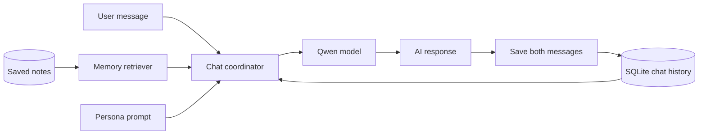

<div align="center">

# PROJECT AOI

### Building a personal AI assistant that can remember

**A local-first conversational AI experiment with a defined personality, persistent chats, and memory retrieval.**


[Overview](#overview) · [Features](#features--development-status) · [Architecture](#how-it-works) · [Run the demo](#quick-start) · [Roadmap](#roadmap)

</div>

---

> [!IMPORTANT]
> **In development.** Aoi is a research and learning project, not a finished AI assistant. The original experimental source files were not available when this public showcase was prepared. The code here is a **reconstructed reference implementation** based on the systems developed and tested in earlier work. The database demo and unit tests run locally. Real model inference and semantic-search quality have not yet been verified for this release. See [Project status](docs/PROJECT_STATUS.md) for the distinction.

## Overview

**Project Aoi** began with a simple question: *Could I build an AI assistant that feels consistent from one conversation to the next, remembers relevant details, and runs on my own computer?*

The goal is not to train a new foundation model. It is to bring several existing pieces together into one assistant:

- **A local language model** to generate replies without a hosted chat API.
- **A defined personality** to keep Aoi's tone and behavior stable.
- **Persistent conversation history** that survives a restart.
- **Long-term memory retrieval** that selects useful context for each conversation.
- **A modular Python codebase** that can later grow into voice, vision, and a character interface.

The first development stage used **Qwen2.5-3B**, **PyTorch**, **Hugging Face Transformers**, **SQLite**, and **SentenceTransformers**. Work focused on model loading, tokenisation, prompt formatting, storage, and retrieval, with end-to-end reliability still being developed.

## Features & development status

| Component | Status | What it means |
| --- | --- | --- |
| Character / persona design | 🟡 Prototyped | Aoi's personality and dialogue style were designed; original prompt not included |
| Qwen-based conversation | 🟡 Prototyped | Local text generation explored; full reliability not established |
| SQLite chat history | 🟢 Included + tested | Stores messages by conversation, role, and timestamp |
| Conversation context | 🟢 Included + tested | Loads recent turns into a new prompt |
| Manual memory notes | 🟢 Included + tested | Adds and removes notes stored across sessions |
| Keyword memory search | 🟢 Included + tested | Lightweight stand-in used by the offline demo |
| Sentence embedding retrieval | 🟡 Integration included | Optional semantic ranking, not part of offline tests |
| Model + memory end-to-end | 🟡 In progress | Needs live quality and stability testing |
| Ubuntu server / remote access | ⚪ Planned | No deployment included |
| Speech, vision, animated avatar | ⚪ Future | Not implemented |

🟢 Verified by repository tests · 🟡 Prototype or unverified integration · ⚪ Planned

## How it works



Aoi forms a prompt from the persona, recent conversation, and matching saved notes. An optional local language model then generates a response. The code saves the user's message and Aoi's response in a single database transaction **after** a successful generation.

The current memory system saves notes only when asked. It does **not** learn new model weights, auto-create verified memories, or solve contradictions between saved notes.

[Read the architecture breakdown](docs/ARCHITECTURE.md)

## Quick start

You can run the **storage demo** without a GPU, model weights, or any external Python packages. Requires Python 3.10 or newer.

### 1. Clone and install

```bash
git clone https://github.com/YOUR-USERNAME/project-aoi.git
cd project-aoi
python -m venv .venv
```

Activate the environment:

**Windows PowerShell**

```powershell
.venv\Scripts\Activate.ps1
```

**Ubuntu / Linux / macOS**

```bash
source .venv/bin/activate
```

Then install the local package:

```bash
python -m pip install -e .
```

If you downloaded the ZIP instead of cloning, extract it and run the same commands from inside its `project-aoi` folder. For the clone command, replace `YOUR-USERNAME` after publishing the repository.

### 2. Run the no-model demo

```bash
python -m aoi demo
```

This creates temporary chat history, stores example notes, and searches them with a **keyword retriever**. Nothing is downloaded. Example output from this repository:

```text
Project Aoi | local storage demonstration
----------------------------------------
Chat messages saved: 2
Long-term notes saved: 2
Search query: 'SQLite chat history'
Matched note #1: Project Aoi stores its conversation history in SQLite.
Demo complete. This mode does not load an AI model.
```

### 3. Run the unit tests

```bash
python -m unittest discover -s tests -v
```

Tests cover message order, conversations, memory persistence, keyword ranking, prompt construction, and handling failed generation without saving partial conversations. They do not benchmark the AI model.

## Optional: Chat with a local model

> **Experimental.** This stage loads model weights and needs a machine with enough RAM and/or VRAM. Model files may be several gigabytes. The default 3B model can be slow or fail on limited hardware. The original prototype was tested on Windows; Ubuntu deployment is still a future goal.

Install optional dependencies:

```bash
python -m pip install -e ".[model,semantic]"
```

Start a terminal conversation with basic keyword retrieval:

```bash
python -m aoi chat --conversation main --retrieval keyword
```

Or try embedding-based retrieval:

```bash
python -m aoi chat --conversation main --retrieval semantic
```

Inside chat:

```text
You > Hello Aoi
You > /remember The project stores memories in SQLite.
You > Can you tell me about the project's memory system?
You > /quit
```

The lines above show **commands to try**, not verified outputs of the Qwen model. Use the included placeholder personality prompt in `src/aoi/persona.py`, or replace it with your own non-sensitive version.

The script reads optional environment variables such as `AOI_MODEL_NAME` and `AOI_DB_PATH`. See [.env.example](.env.example). It does not load `.env` files automatically. You can choose a smaller compatible chat model if your hardware cannot run the 3B default.

## Code highlights

### SQLite: keep both sides of a conversation

```python
with self._connect() as connection:
    connection.executemany(
        "INSERT INTO messages (conversation_id, role, content, created_at) "
        "VALUES (?, ?, ?, ?)",
        [
            (conversation_id, "user", user_text, timestamp),
            (conversation_id, "assistant", reply_text, timestamp),
        ],
    )
```

This avoids leaving only the user's message if model generation fails.

[View `storage.py`](src/aoi/storage.py)

### Memory: rank notes against the current question

```python
embeddings = model.encode(
    [query] + [memory.content for memory in memories],
    normalize_embeddings=True,
)
query_vector = embeddings[0]
scored = [
    (float(query_vector @ vector), memory)
    for memory, vector in zip(memories, embeddings[1:])
]
```

The optional semantic retriever ranks stored notes by similarity and keeps those above a configured threshold. This is a small prototype and does not yet use a vector database or cached embeddings.

[View `retrieval.py`](src/aoi/retrieval.py)

### Model: decode only newly generated tokens

```python
response_ids = output_ids[0][inputs["input_ids"].shape[-1]:]
text = tokenizer.decode(response_ids, skip_special_tokens=True).strip()
```

This extracts the generated reply rather than treating the prompt as part of the answer.

[View `model.py`](src/aoi/model.py)

## Tech stack

| Tool | Role |
| --- | --- |
| **Python** | Main application, CLI, and coordination |
| **PyTorch** | Model inference backend |
| **Qwen2.5-3B-Instruct** | Local conversational model used in prototype experiments |
| **Hugging Face Transformers** | Loading, tokenisation, and text generation |
| **SQLite** | Conversation history and explicit notes |
| **SentenceTransformers** | Embedding-based search of relevant notes |
| **GitHub Actions** | Runs lightweight tests and demo in CI |

## Repository structure

```text
project-aoi/
├── .github/workflows/tests.yml  # lightweight checks
├── docs/
│   ├── index.html               # optional GitHub Pages website
│   ├── ARCHITECTURE.md
│   ├── DEVELOPMENT_LOG.md
│   ├── PROJECT_STATUS.md
│   ├── PORTFOLIO_TEXT.md
│   └── GITHUB_SETUP.md
├── examples/                    # verified storage demo output
├── src/aoi/
│   ├── assistant.py             # model + memory + history
│   ├── cli.py                   # demo and chat commands
│   ├── config.py                # environment configuration
│   ├── model.py                 # optional Qwen backend
│   ├── persona.py               # replaceable public persona
│   ├── retrieval.py             # memory search
│   └── storage.py               # SQLite storage
├── tests/                       # offline unit tests
├── .env.example
├── .gitignore
├── pyproject.toml
└── README.md
```

## Challenges and what I learned

The hardest part was not just loading a model. It was making the parts behave as one system. I worked through **empty responses, token and tensor shape issues, SQLite setup, memory sorting, and preserving conversation order**. I also learned that remembering a fact is different from simply including an old message in a prompt.

The work strengthened my skills in Python development, machine learning tools, working with local models, database design, debugging, and breaking a large problem into testable parts.

[Read the development log](docs/DEVELOPMENT_LOG.md)

## Roadmap

- [x] Define the assistant concept and desired identity
- [x] Experiment with local Qwen text generation
- [x] Prototype conversation storage with SQLite
- [x] Explore sentence embedding memory retrieval
- [x] Rebuild the architecture as a testable public showcase
- [ ] Verify model replies and semantic retrieval end to end
- [ ] Improve consistency of Aoi's personality over longer conversations
- [ ] Let users review, correct, and remove memories safely
- [ ] Test memory retrieval with a repeatable evaluation set
- [ ] Reduce RAM and GPU requirements
- [ ] Deploy a stable local service on Ubuntu
- [ ] Add optional voice, vision, and a character interface

## Documentation

- [Architecture](docs/ARCHITECTURE.md)
- [Project status and evidence](docs/PROJECT_STATUS.md)
- [Development log](docs/DEVELOPMENT_LOG.md)
- [Portfolio and CV description](docs/PORTFOLIO_TEXT.md)
- [How to publish on GitHub and enable GitHub Pages](docs/GITHUB_SETUP.md)

## Privacy & scope

Chat histories and notes are stored as **unencrypted local SQLite data**. Avoid placing personal secrets in demo data or a public repository. The code does not include hosted AI keys, paid API integrations, live services, or model weights. There is no completed voice interface or independent learning agent in this release.

## Project note

Built as a personal learning and development project. The repository documents an ongoing experiment, including what worked, what is still being tested, and where it could go next.

*Project Aoi: an attempt to build an AI assistant that can carry context forward, not just answer one message at a time.*
