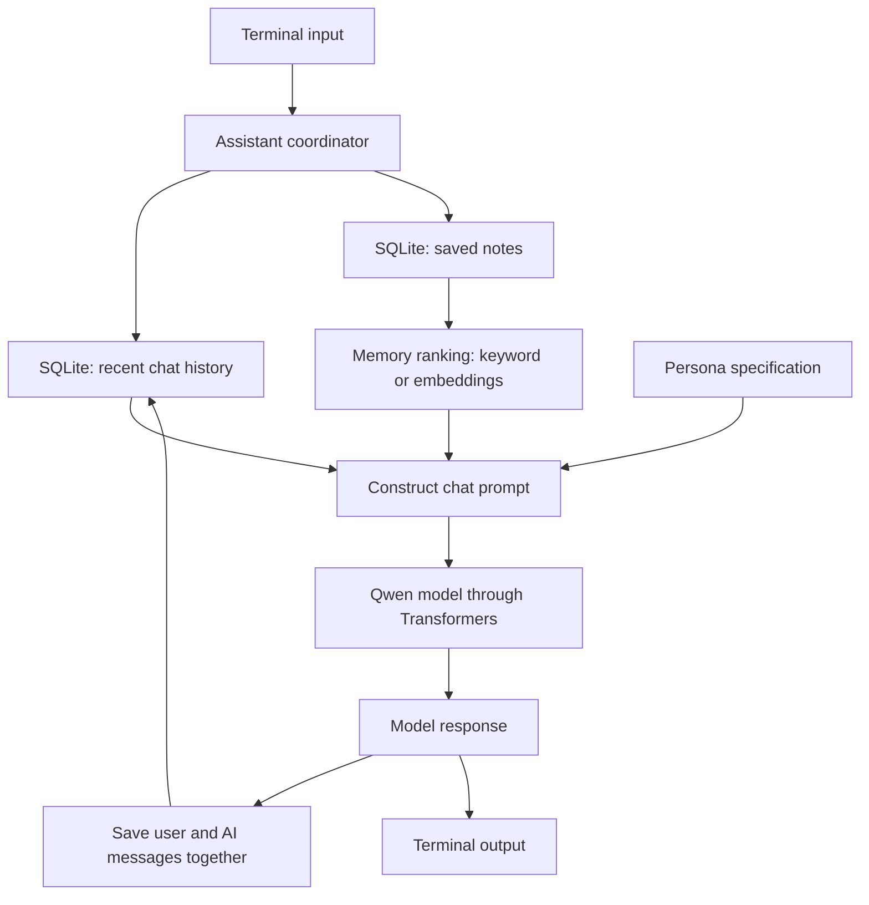

# Architecture

Aoi is a local-first research prototype. It separates storage, search, persona, and generation so each piece can be developed on its own.

## Data flow

1. The terminal passes a message and conversation ID to `AoiAssistant`.
2. SQLite returns the recent messages for that conversation.
3. The memory store returns explicit notes. A retrieval method ranks them for the new message.
4. Aoi builds a system prompt containing the persona and relevant notes, followed by recent history and the new message.
5. The optional local model generates a reply. Only if generation succeeds do both sides of the exchange get written to SQLite.

## Important boundaries

- Recent history and long-term memories are **different tables**. Notes do not get created from chats without the `/remember` command.
- The semantic retriever encodes up to 250 stored notes per request. This is for prototyping, not large-scale use.
- SQLite data is stored in plain text locally. It is not encrypted. Do not use real private information in a public demo.
- The current prompt injects retrieved notes as text, without trust checks or a system for resolving conflicting memories. It is not resistant to prompt injection.
- There is no training or fine-tuning loop. "Learning" here means storing and retrieving explicit information, not updating the model's weights.
- The provided public persona is a placeholder. The earlier detailed Aoi character specification is not included.

## Database design

| Table | Fields | Purpose |
| --- | --- | --- |
| `messages` | `id`, `conversation_id`, `role`, `content`, `created_at` | Keeps role-labelled chats in order |
| `memories` | `id`, `content`, `source`, `created_at` | Stores explicit, searchable long-term notes |

## Main files

| File | Responsibility |
| --- | --- |
| `storage.py` | SQLite schema and persistence |
| `retrieval.py` | Keyword demo and optional embedding search |
| `model.py` | Tokenisation, generation and reply decoding |
| `persona.py` | Public placeholder for Aoi's personality prompt |
| `assistant.py` | Joins history, memories, model and storage |
| `cli.py` | Terminal demo and chat commands |

## Future architecture improvements

A robust memory system would add note consent, editing, automatic conflict handling, dedicated embedding storage, privacy controls, memory evaluation, and prompt-injection defenses. Those are not in this version.
